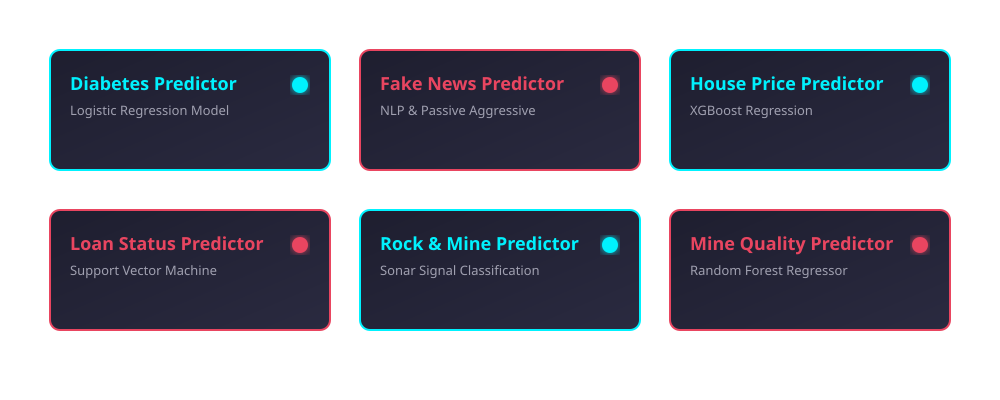
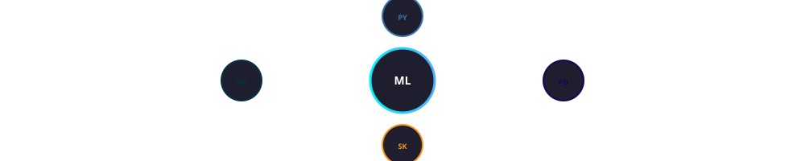

<!-- ================= ANIMATED HEADER ================= -->

  

<!-- ================= STATUS BADGES ================= -->

  
  
  
  

---

<!-- ================= ABOUT SECTION ================= -->
## 🚀 About The Repository

Welcome to my **50 Days of Machine Learning** challenge! This repository documents my structured, self-paced journey through the core concepts of Machine Learning. Over 50 days, I am building hands-on projects that cover the entire lifecycle of an ML model—from **data preprocessing** and **exploratory data analysis (EDA)** to **model training** and **evaluation**.

The goal is to master the implementation of algorithms using **Python**, **Scikit-Learn**, **Pandas**, and **Matplotlib**.

  

<!-- ================= PROJECT SHOWCASE ================= -->
## 📂 Project Showcase

Here is a breakdown of the projects currently available in this repository. Each project is a standalone module focusing on a specific ML algorithm.

  

### Detailed Project Breakdown

| 🧠 Project Name | 📝 Description | 🛠️ Tech Stack | 📊 Algorithm |
| :--- | :--- | :--- | :--- |
| **[Diabetes Predictor](https://github.com/AHMAD-0702/50--Days--OF--Machine--Learning/tree/main/Diabetes%20Predictor)** | Predicts the likelihood of diabetes based on diagnostic measures. | Python, Scikit-Learn, Pandas | Logistic Regression |
| **[Fake News Predictor](https://github.com/AHMAD-0702/50--Days--OF--Machine--Learning/tree/main/Fake%20News%20Predictor)** | An NLP-based classification model to detect fake news articles. | Python, Scikit-Learn, NLTK | Passive Aggressive |
| **[House Price Predictor](https://github.com/AHMAD-0702/50--Days--OF--Machine--Learning/tree/main/House%20Price%20Predictor)** | Regression model to estimate real estate prices. | Python, Scikit-Learn, Matplotlib | XGBoost / Linear |
| **[Loan Status Predictor](https://github.com/AHMAD-0702/50--Days--OF--Machine--Learning/tree/main/Loan%20Status%20Predictor)** | Classification model to approve or reject loan applications. | Python, Scikit-Learn, Seaborn | SVM |
| **[Rock And Mine Predictor](https://github.com/AHMAD-0702/50--Days--OF--Machine--Learning/tree/main/Rock%20And%20Mine%20Predictor)** | Sonar signal classification to differentiate Rocks vs Mines. | Python, Scikit-Learn, NumPy | Logistic Regression |
| **[Mine Quality Predictor](https://github.com/AHMAD-0702/50--Days--OF--Machine--Learning/tree/main/Mine%20Quality%20Predictor)** | Predicts the quality of mined materials using regression. | Python, Scikit-Learn, Pandas | Random Forest |
| **[Wine Quality Predictor](https://github.com/AHMAD-0702/50--Days--OF--Machine--Learning/tree/main/Wine%20Quality%20Predictor)** | Predicts wine quality based on physicochemical tests. | Python, Scikit-Learn, Matplotlib | Random Forest |
| **[Titanic Survival Predictor](https://github.com/AHMAD-0702/50--Days--OF--Machine--Learning/tree/main/Titanic%20Survival%20Predictor)** | Predicts passenger survival on the Titanic. | Python, Scikit-Learn, Pandas | Random Forest |
| **[Iris Flower Classifier](https://github.com/AHMAD-0702/50--Days--OF--Machine--Learning/tree/main/Iris%20Flower%20Classifier)** | Classifies iris flowers into three species. | Python, Scikit-Learn, Seaborn | K-Nearest Neighbors |
| **[Credit Card Fraud Detection](https://github.com/AHMAD-0702/50--Days--OF--Machine--Learning/tree/main/Credit%20Card%20Fraud%20Detection)** | Detects fraudulent credit card transactions. | Python, Scikit-Learn, Imbalanced-Learn | Isolation Forest |

  

<!-- ================= TECH STACK ================= -->
## 🛠️ Tech Stack & Tools

  
  
  
  
  
  

  

  

<!-- ================= GITHUB STATS ================= -->
## 📈 GitHub Stats

  
  

  

  

<!-- ================= CONNECT ================= -->
## 🤝 Connect With Me

  
  
  

<!-- ================= ANIMATED FOOTER ================= -->

  

